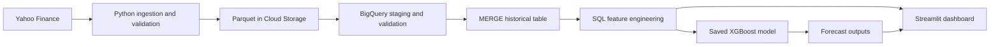

# FinFlow GCP

FinFlow is an end-to-end financial data pipeline that collects daily prices for ten Indian stocks, stores historical data in Google Cloud, builds analytical features with SQL, and generates next-trading-session return forecasts using XGBoost. A Streamlit dashboard displays stock history, forecasts, and model evaluation results.

## How it works

1. **Extract market data:** Download daily OHLCV and adjusted-close data from Yahoo Finance using `yfinance`. Stocks without stored history start from January 2020.
2. **Download incrementally:** Read the latest stored trading date for each stock and download with a seven-calendar-day overlap to capture recent revisions. Exclude today's potentially incomplete session.
3. **Validate local data:** Check the expected number of files, empty data, missing values, duplicate stock/date records, price ranges, and negative volume. Add a batch ID and UTC ingestion timestamp to each record.
4. **Land files in Cloud Storage:** Save each stock as a Parquet file and upload it under `raw/stocks/`. Keep batches separate for traceability and reprocessing.
5. **Load and validate staging:** Replace the BigQuery staging table with the uploaded batch. Check row counts, stock coverage, batch identity, duplicate keys, missing fields, invalid dates, and price/volume rules.
6. **Merge historical records:** Match on `symbol` and `trade_date`. Insert missing records and update existing records when the incoming ingestion timestamp is newer. Reprocessing an identical batch makes no further changes.
7. **Build SQL features:** Refresh the date-partitioned, symbol-clustered feature table using window functions: daily return, 5/20-session price averages, 5/20-session volume averages, and 20-return volatility.
8. **Generate forecasts:** Load the saved active model and predict next-session returns from the latest available features. Daily runs do not retrain the model.
9. **Explore results:** Use the dashboard to inspect historical data, latest forecasts, model metrics, and the latest run status.



## Model and evaluation

One **XGBoost regressor** is trained across all ten stocks to predict the next trading session's adjusted-close return. Predictions use information available after the current session closes.

Model inputs:
- Current daily return.
- 20-session rolling return volatility.
- Adjusted close divided by its 5-session moving average, minus one.
- Adjusted close divided by its 20-session moving average, minus one.
- Current volume divided by its 20-session average volume.

The baseline predicts the mean of the stock's latest **seven observed trading-session returns**. Data is split chronologically by unique trading dates, approximately 70% training, 15% validation, and 15% testing. Stocks share date boundaries, and rows whose targets cross split boundaries are excluded. Early stopping uses validation RMSE; the test set is reserved for evaluation.

### Saved active model

The following results come from the active `models/metadata.json` and `outputs/test_metrics.csv`, rather than an earlier experimental run.

| Split | Rows | Feature dates |
|---|---:|---|
| Training | 11,680 | 2020-01-29 to 2024-10-17 |
| Validation | 2,500 | 2024-10-21 to 2025-10-21 |
| Test | 2,510 | 2025-10-24 to 2026-10-29 |

Test targets extend through **2026-10-30**. Parameters include a learning rate of 0.03, maximum depth of 3, up to 500 trees, subsampling and column sampling of 0.8, L2 regularisation of 10, and early stopping after 30 rounds. The saved model's best iteration uses **107 trees**.

| Model | Test MAE | Test RMSE |
|---|---:|---:|
| 7-session mean baseline | 0.011840 | 0.016169 |
| XGBoost | **0.011024** | **0.015345** |

XGBoost reduced test MAE by approximately **6.9%** and RMSE by **5.1%** relative to the baseline. Both metrics improved for each of the ten stocks in the saved evaluation. Returns are decimal fractions: MAE 0.011024 corresponds to approximately **1.1024 percentage points**. These metrics measure forecasting error, not trading profitability.

## Technology

Python, Pandas, NumPy, yfinance, Parquet/PyArrow, Google Cloud Storage, BigQuery and GoogleSQL, XGBoost, scikit-learn, Streamlit, Plotly, and Windows Task Scheduler.

## Project structure

```text
config.py                     Cloud identifiers, stock universe, and paths
run_pipeline.py               Train and daily entry points
pipeline/ingestion.py         Downloads, local checks, and uploads
pipeline/warehouse.py         BigQuery loading, checks, merges, and queries
pipeline/model.py             Features, training, evaluation, and forecasting
pipeline/runtime.py           Run logs and overlap protection
sql/                          SQL transformations and validation
models/versions/               Candidate models and evaluation artifacts
outputs/                      Active evaluation results and latest forecasts
logs/                         Run summaries and detailed logs
dashboard.py                  Streamlit application
activate_model.py             Explicit model promotion
scripts/register_daily_task.ps1  Windows scheduling setup
tests/                        Offline operational tests
```

## Setup

### 1. Python environment

Use Python 3.11 and run these commands from the project directory:

```powershell
python -m venv .venv
.\.venv\Scripts\Activate.ps1
python -m pip install -r requirements.txt
```

### 2. Google Cloud

Install the Google Cloud CLI, then authenticate:

```powershell
gcloud init
gcloud auth application-default login
```

Update `config.py` with your project ID, bucket name, dataset/table identifiers, and region. Enable the Cloud Storage and BigQuery APIs. Create the bucket and the `finflow` BigQuery dataset in the same region; this project uses `us-central1`. Keep the bucket private and use uniform bucket-level access. Your identity needs permission to manage the project data and run BigQuery jobs.

Cloud services require an appropriate billing setup. Free-tier allowances and trial credits have limits; review actual Cloud Billing reports. Budget alerts do not cap spending.

### 3. Initial historical load

A fresh setup needs bootstrapping before daily mode: the latest-date query expects `finflow.raw_stock_prices` to exist, and daily forecasting expects an active model.

Create the initial raw table with the schema used in `pipeline/warehouse.py`, partitioned by `trade_date` and clustered by `symbol`. An empty table allows the downloader to fall back to January 2020. Run the ingestion sequence through feature refresh without loading a model: download, validate, upload, load staging, merge, and refresh features. Then train and activate the first candidate as described below. Models, outputs, and downloaded market data are intentionally excluded from Git, so cloning the repository does not supply them.

## Running the project

### Train a candidate

```powershell
python run_pipeline.py --mode train
```

Training saves model, metadata, test predictions, and metrics to a new directory under `models/versions/`. Reload verification checks saved predictions. Training does not replace the active model automatically.

Review a candidate before explicitly activating it:

```powershell
python activate_model.py VERSION_FOLDER_NAME
```

Activation archives previous active artifacts before copying the candidate into the active paths. Restart the dashboard after activation. For future experiments, freeze evaluation boundaries deliberately; the current split builder derives boundaries from available history. Do not repeatedly tune against the final test results.

### Run ingestion and forecasting

```powershell
python run_pipeline.py --mode daily
```

Daily mode uses the active model, processes the batch, refreshes SQL features, and writes `outputs/latest_forecasts.parquet`. Forecasts include the last observed trading date and generation timestamp; the horizon is the next trading session, not necessarily the next calendar day.

### Open the dashboard

```powershell
python -m streamlit run dashboard.py
```

### Schedule daily execution on Windows

```powershell
.\scripts\register_daily_task.ps1
```

The default task runs daily at **18:30 Windows local time**. The verified computer uses India Standard Time. It uses the project's venv and working directory, runs while the user is logged in, and ignores overlapping starts. Inspect or change the task in Windows Task Scheduler.

## Logging and verification

Each run creates a JSON summary and text log in `logs/`; `latest.json` supplies dashboard status. Summaries record status, timing, and daily batch counts. Errors propagate as nonzero exit codes. A shared lock prevents concurrent pipeline, training, and activation runs. After a forced termination, verify the recorded process is no longer running before removing a stale lock.

```powershell
python -m unittest discover -s tests -v
```

Four offline tests cover logging on success/failure, overlap protection, invalid staging blocking the merge, and unexpected-stock rejection. Live verification on 2026-11-09 confirmed a successful scheduled run, ten forecasts, zero affected rows on repeating the staged batch, and zero duplicate historical stock/date keys.

## Data and scope

The stock universe is RELIANCE, TCS, HDFCBANK, ICICIBANK, INFY, ITC, LT, SBIN, BHARTIARTL, and HINDUNILVR, using Yahoo's `.NS` symbols. Data is accessed through yfinance for personal educational research; it is not a guaranteed production market-data feed.

The seven-calendar-day overlap captures recent revisions, but older corporate-action adjustments require a full-history refresh. Historical data is not a point-in-time snapshot. Feature refresh currently rebuilds the full feature table. Actual cloud costs depend on usage and have not been measured in this README. Credentials, local market data, logs, and model artifacts must remain outside the public repository.
